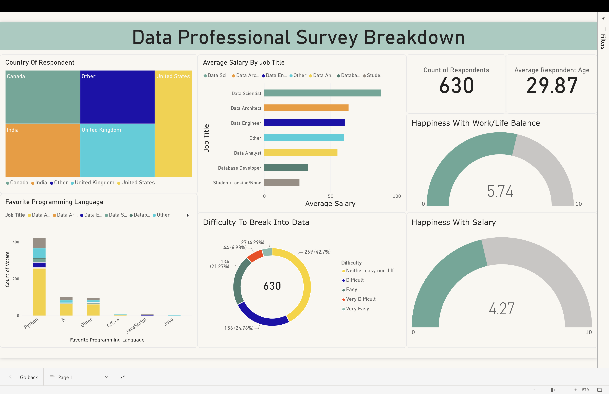

# Data Professional Survey Dashboard

A Power BI portfolio project exploring the roles, programming preferences, demographics, and job satisfaction of 630 survey respondents.

## Dashboard preview

## Overview

This project provided practice importing survey data, preparing fields, selecting aggregations, building interactive visuals, and formatting a report on Power BI.

This repository presents my implementation and documents findings as well as the source workbook.

## Questions explored

- Which job roles and programming languages are most common among respondents?
- How do estimated salaries compare across job titles?
- Where do respondents live?
- How satisfied are respondents with work-life balance and salary?
- How difficult did respondents find entering the data field?

## Tools and skills

- **Power BI service:** Browser-based report authoring and interactive visualizations.
- **Power Query:** Data preparation and category cleanup.
- **Semantic model:** Numeric data types and field properties.
- **Aggregations:** Distinct respondent counts and average age, salary estimates, and satisfaction ratings.
- **Visual design:** Cards, bar and stacked column charts, a treemap, and gauges.

## Findings checked against the source workbook

These figures describe the full source dataset, with no country or job-role selection applied.

| Metric | Result |
|---|---:|
| Unique respondents | 630 |
| Average respondent age | 29.87 years |
| Average work-life balance satisfaction | 5.74 / 10 |
| Average salary satisfaction | 4.27 / 10 |
| Respondents choosing Python | 420 (66.7%) |
| Respondents identifying as Data Analysts | 381 (60.5%) |
| Respondents reporting entry into data as Difficult or Very Difficult | 200 (31.7%) |

Python was the most frequently selected programming language. Average work-life balance satisfaction exceeded average salary satisfaction by about 1.47 points. These are descriptive findings about this sample, rather than conclusions about all data professionals.

## Data preparation and calculation notes

- The source worksheet, **Data Professional Survey**, contains 630 response rows and 28 columns. Each response has a distinct Unique ID.
- Job titles and other survey fields contain free-text “Other” responses. Grouping these responses affects category counts and comparisons.
- Reported annual salary is supplied as a **range**, not an exact salary. Numeric salary estimates derived from these ranges are approximations. The highest band, **225k+**, has no upper bound, so its estimate requires an explicit assumption.
- The Average Salary field must use a numeric data type and the **Average** aggregation for salary comparisons.
- Satisfaction ratings range from 0 to 10. Numeric zeros are valid responses and are included. Empty or nonnumeric entries are excluded from the benchmark means: work-life balance has 620 numeric responses and salary satisfaction has 623.
- Selecting a country or another chart category changes the context of the cards and gauges. Clear chart selections to reproduce the full-dataset benchmarks above.
- Salary rankings are not presented here as verified findings because they depend on the report’s salary conversion and category-cleaning steps.

## Files and viewing

- **dashboard.png** — Static preview of the report, displayed above.
- **README.md** — Project context, findings, calculation notes, and attribution.

The original dataset is available through the source repository linked below. If this repository also includes a PDF export, it is a static view; a PBIX file, if provided, requires a compatible Power BI environment. The screenshot does not provide interactive filtering or preserve the report model.

## Limitations

This is a self-selected survey sample and should not be treated as representative of the entire data workforce. Salary estimates are based on bands, and small job-role groups can produce unstable averages. The survey is historical and does not establish current salary levels.

## Source and acknowledgement

This is a guided learning project based on **Alex The Analyst’s [Full Power BI Guided Project | Microsoft Power BI for Beginners](https://www.youtube.com/watch?v=pixlHHe_lNQ)**.

- [Alex The Analyst’s Power BI source repository](https://github.com/AlexTheAnalyst/Power-BI)
- Workbook used for this implementation: **Power BI - Data Professional Project.xlsx**

Credit for the tutorial and source material belongs to its original creator. My contribution is the report implementation and its portfolio presentation; I did not collect the survey data.

